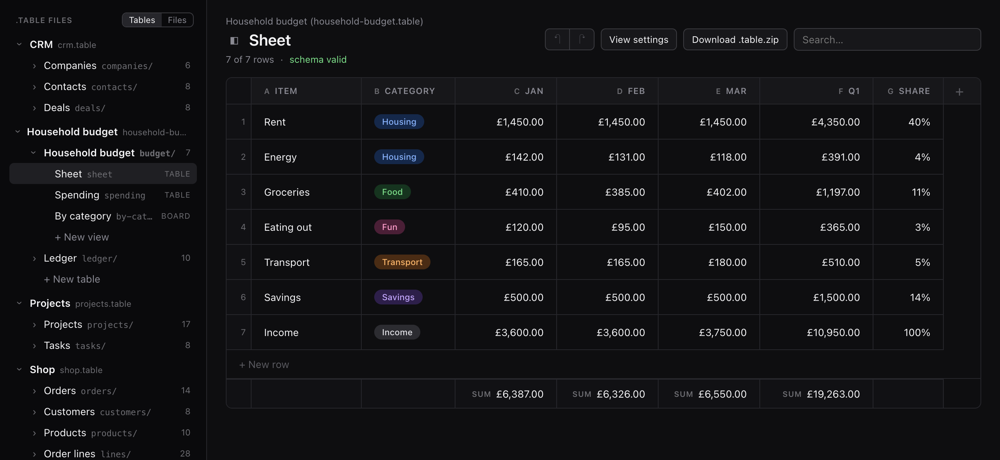

# `.table`

<p align="center">
  <picture>
    <source media="(prefers-color-scheme: dark)" srcset="docs/.assets/table.logo.dark.svg">
    <source media="(prefers-color-scheme: light)" srcset="docs/.assets/table.logo.light.svg">
    
  </picture>
</p>

**A database you can keep in a folder.**

`.table` is an open file format for the tables people build in Airtable,
Notion or a spreadsheet: typed columns, linked tables, formulas, and
views such as boards and calendars.

What's different is where it lives. A `.table` is a file on your own
disk, not a workspace on someone else's server. Inside it is plain text:
a schema, and one line per row. Any tool can read it, git can track it,
and you never need the app that made it to get your data back.

It is for people who work with information, not only for developers.
Opened in an app, it looks and edits like the tools you already know.

**[Try the demo in your browser](https://workspace-sh.github.io/table-file-format/)**:
nothing is uploaded, and edits stay in that browser.

<p align="center">
  <a href="docs/SCREENSHOTS.md"></a>
</p>

> **Status.** The format is frozen at `formatVersion: 1`, and changes
> from here only add to it. The library and the apps in this repository
> are a reference implementation: they work and are tested, they are not
> on npm yet, and their API may change before 1.0.

## Why

Tables move between tools badly. CSV loses the types. `.xlsx` and
`.numbers` are binary and belong to one app. Airtable, Notion and Google
Tables keep the data on their servers. None of them is open, typed,
comparable line by line and self-contained at once.

`.table` aims to be all four, and to hold what a real Airtable base
holds: several linked tables, attachments, a long note on any row, and
every saved view.

## What's on disk

A `.table` is a folder that behaves as one file, as a macOS `.app` does.

```
crm.table/
├── meta.json              the file's title, and the order of its tables
├── tables/
│   ├── companies/
│   │   ├── schema.json    the fields: names, types, constraints, formulas
│   │   ├── rows.ndjson    the rows, one JSON object per line
│   │   ├── views.json     saved views: table, board, gallery, list, calendar
│   │   ├── bodies/        a markdown document for any row that has one
│   │   └── attachments/   files that rows refer to
│   └── deals/…
└── index.sqlite           a cache for querying and search; safe to delete
```

Only `schema.json` and `rows.ndjson` are required. A row is a line:

```json
{"id":"p1","title":"Workspace v1","status":"active","owner":"leslie","budget":80000,"launched":"2026-01-15"}
```

and a field is an entry in the schema:

```json
{ "name": "budget", "type": "number", "format": "currency:USD" }
```

The whole format is in [docs/SPEC.md](docs/SPEC.md), and the reasons
behind it in [docs/DECISIONS.md](docs/DECISIONS.md).

## What a table can hold

- **Typed fields.** Text, numbers, booleans, dates, times, durations,
  lists, objects and places. Each type has one exact encoding, so two
  readers of the same file see the same values.
- **Constraints.** Required, unique, a set of choices, a range, a
  length, a pattern.
- **Relations.** A field can point at rows in another table of the same
  file.
- **Formulas.** Typed as in a spreadsheet (`=round(budget / 12, 0)`) and
  stored in one canonical form. A formula can read other rows, follow a
  relation to look a value up, and total the rows that point back. Its
  result is worked out when the table is read and never stored, so it
  can't go stale.
- **Views.** Any number of saved views of a table, each with its own
  filter, sort, grouping, columns and totals, laid out as a table, a
  board, a gallery, a list or a calendar. A Sheet view letters its
  columns and numbers its rows, so a formula can refer to `B7`.
- **A document per row.** A row can carry a long markdown body, kept as
  its own file.
- **Attachments.** Files stored beside the rows that refer to them.
- **History.** An optional append-only log of edits. It is specified;
  the apps here don't write it yet.

A `.table` also travels as a single `.table.zip`, and a table goes in
and out as CSV.

## Reading one in code

`@workspace.sh/table-core` is the reference library, in TypeScript. It
runs in Node, in browsers and in React Native.

```ts
import { parseBundle } from "@workspace.sh/table-core/parser";
import { applyView, validate } from "@workspace.sh/table-core";

const file = await parseBundle("./fixtures/projects.table");
const projects = file.tables.projects!;

// Check the rows against the schema.
const problems = validate(projects.schema, projects.rows);

// The rows a saved view shows: filtered, sorted, formulas worked out.
const view = projects.views.find((v) => v.name === "Active by owner")!;
const rows = applyView(projects, view);
```

[docs/INTEGRATION.md](docs/INTEGRATION.md) is the guide to using it from
an app, including writing, archives and CSV. It also describes the
smallest reader worth writing in another language.

## The apps

Each app opens the same files and shows the same views. They exist to
prove the format and the libraries, and to be read as examples.

| Platform | Where | Built with |
|---|---|---|
| Web | `apps/web` | React and [react-strict-dom](https://github.com/facebook/react-strict-dom). This is the [live demo](https://workspace-sh.github.io/table-file-format/). |
| iOS | `apps/mobile` | Expo and React Native, with the system's own controls. iOS 26 and later. |
| macOS | `apps/desktop` | react-native-macos, in a native window with a sidebar, toolbar and inspector. |
| Linux | `apps/linux` | GTK 4 and libadwaita, through [GTKX](https://gtkx.dev). |
| Android | `apps/mobile` | The same code as iOS, with Material controls. It is behind the others; what's missing is listed in [#429](https://github.com/workspace-sh/table-file-format/issues/429). |

The web, iOS, macOS and Android apps draw their views with
`@workspace.sh/table-ui`, written once for all four. Linux draws the same
views as GTK widgets with `@workspace.sh/table-gtk`. Where the platforms
do differ is listed in [docs/PLATFORMS.md](docs/PLATFORMS.md).

### Large tables

A table of 50,000 rows or more is read through `index.sqlite` and not
held in memory, and an app loads only the rows near the screen. The
web, Linux and iOS apps open tables of a million rows this way. What was
measured, and how, is in [docs/LARGE-TABLES.md](docs/LARGE-TABLES.md).

## Running it

Needs Node 22.20.0 (`.nvmrc`).

```sh
npm install
npm run web:dev      # the web app, at http://localhost:5173
npm run core:test    # the format library's tests
```

The other apps need their platform's tools, and each has its own notes:
[iOS and Android](apps/mobile/README.md), [macOS](apps/desktop/README.md),
[Linux](apps/linux/README.md). Every command is listed in
[docs/DEVELOPING.md](docs/DEVELOPING.md).

## What's in this repository

```
packages/
  core/                     the format: read, write, validate, query, formulas, index
  ui/                       the views, for web, iOS, Android and macOS
  gtk/                      the same views for GTK on Linux
  app/                      what an app around the views does: state, undo, settings, archives
  conformance/              formula test cases from OpenFormula, and a runner
  table-fixtures/           the fixtures, built in for the apps that can't read the folder
  glass-bar/, file-browser/ parts of the iOS app's interface
apps/                       web, mobile, desktop, linux
fixtures/                   the .table files every app and test uses
docs/                       the specification and everything behind it
```

## Documentation

| | |
|---|---|
| [SPEC](docs/SPEC.md) | The format, in full. |
| [DECISIONS](docs/DECISIONS.md) | Each choice in the format, numbered, with its reasons. |
| [INTEGRATION](docs/INTEGRATION.md) | Using `.table` from your own app. |
| [PRIOR-ART](docs/PRIOR-ART.md) | The formats this was compared against. |
| [ARCHITECTURE](docs/ARCHITECTURE.md) | How the libraries and apps are put together. |
| [PLATFORMS](docs/PLATFORMS.md) | Where the views fork by platform, and how to replace a control. |
| [APP-STATE](docs/APP-STATE.md) | The one reducer every app shares. |
| [LARGE-TABLES](docs/LARGE-TABLES.md) | Measurements from 10,000 to 1,000,000 rows. |
| [BENCHMARKING](docs/BENCHMARKING.md) | How to measure, so numbers can be compared. |
| [STORAGE-AND-SYNC](docs/STORAGE-AND-SYNC.md) | How the files relate to a database and to sync. |
| [PERMISSIONS](docs/PERMISSIONS.md) | A design for access control under sync. Not implemented. |
| [VERSIONING](docs/VERSIONING.md) | Version and build numbers. |
| [DEVELOPING](docs/DEVELOPING.md) | Every command. |
| [SCREENSHOTS](docs/SCREENSHOTS.md) | The web app, showing the sample files. |

## Status

**The format** is stable. It was frozen at `formatVersion: 1` in July
2026, and anything added since is optional and ignored by a reader that
doesn't know it.

**The library and apps** are in active development. What is being worked
on, and what is left, is on the
[project board](https://github.com/orgs/workspace-sh/projects/7).

**Not in the format, on purpose:** sync and real-time collaboration. A
`.table` is a file, and moving it between people and devices is the job
of the app that holds it. The reasoning is in
[DECISIONS](docs/DECISIONS.md) (D14 and D17) and
[STORAGE-AND-SYNC](docs/STORAGE-AND-SYNC.md).

`.table` is developed as part of
[Workspace](https://github.com/workspace-sh), and is meant to be useful
without it.

## Licence

[MIT](LICENSE).
