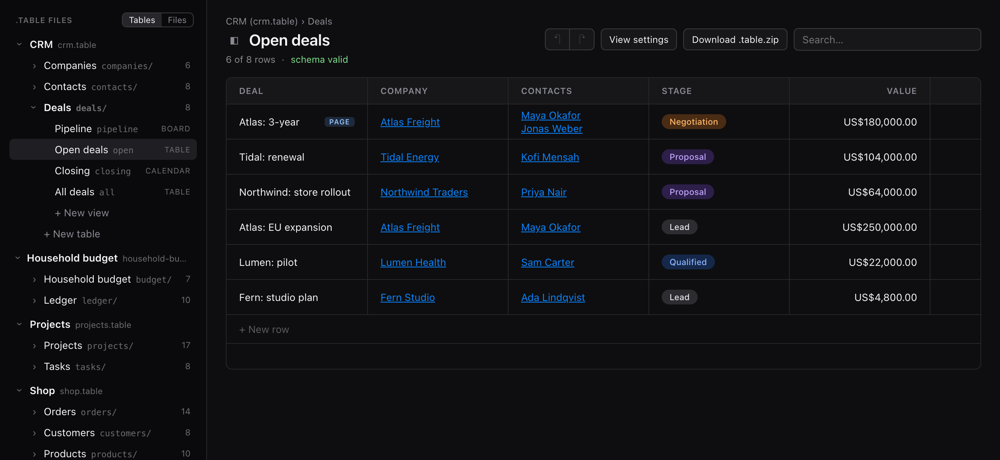
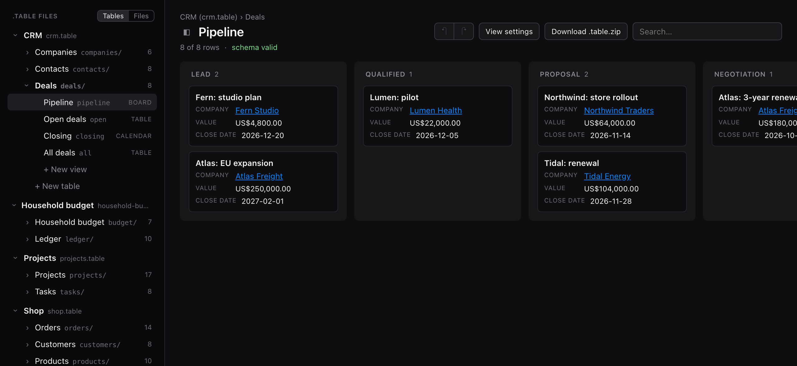

# Screenshots

The web app, showing the sample files in `fixtures/`. Each is the
[live demo](https://workspace-sh.github.io/table-file-format/) at the
address given, so it can be opened and compared.

## A sheet

Columns lettered and rows numbered, formulas in `Q1` and `Share`, and a
total under each month.
[`household-budget.table#table=budget&view=sheet`](https://workspace-sh.github.io/table-file-format/#household-budget.table#table=budget&view=sheet)

## A table

A filtered view of deals. Company and Contacts are relations to rows in
two other tables of the same file.
[`crm.table#table=deals&view=open`](https://workspace-sh.github.io/table-file-format/#crm.table#table=deals&view=open)

## A board

The same deals, grouped into columns by stage.
[`crm.table#table=deals&view=pipeline`](https://workspace-sh.github.io/table-file-format/#crm.table#table=deals&view=pipeline)

